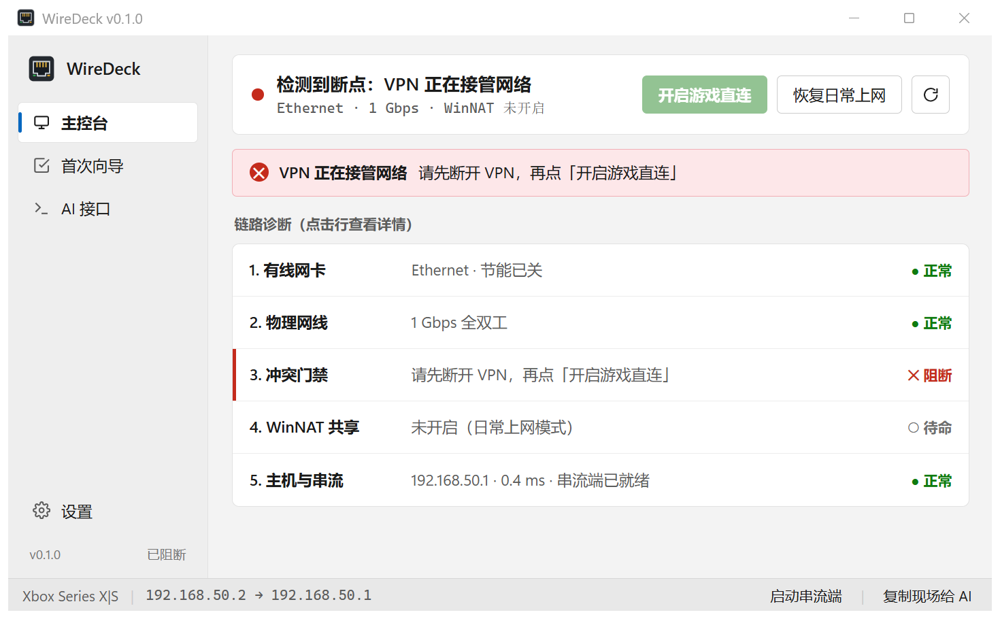
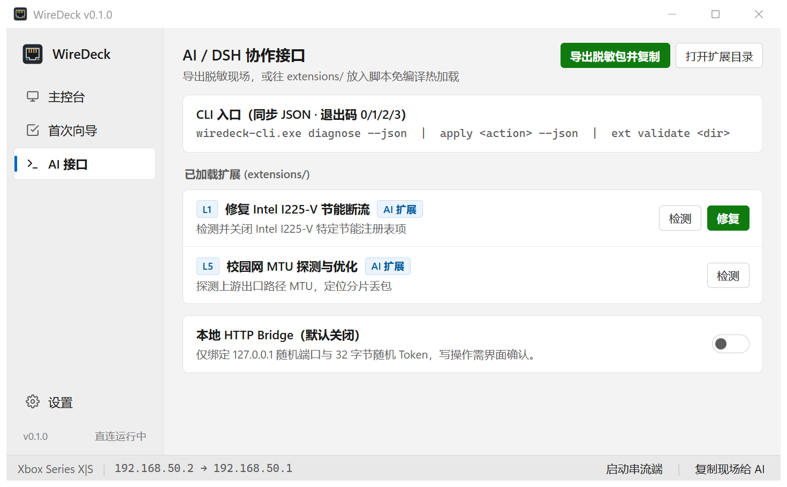
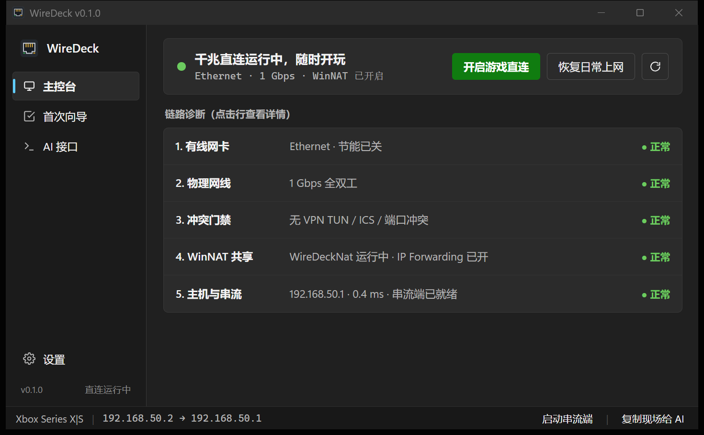

<div align="center">
  
  <h1>WireDeck</h1>
  <p><strong>笔记本与游戏机千兆有线直连助手 · 6 层断点定位 · 零重启 WinNAT 切换 · 原生 AI / DSH 扩展接口</strong></p>
  <p>
    
    
    
    
    
  </p>
</div>

---

一根千兆网线直连笔记本与游戏机（**Xbox Series X|S 满血闭环**，**PS5 / 通用主机轻量支持**），免采集卡、免额外路由器，避开 Windows ICS 冲突、VPN TUN 断流、PCIe 网卡休眠与微软商店回环隔离，看着状态灯点两下即可稳定 60fps 串流开玩。

## 实机界面一览

<p align="center">
  
</p>

| 精准定位断点（零废话一句提示 + 一键修复） | 4 步首次准备向导（自动跳过已达标项） |
| :---: | :---: |
|  |  |

<details>
<summary>展开查看 AI / DSH 协作接口与中性深灰模式截图</summary>
<p align="center">
  
  
</p>
</details>

---

## 3 步极简上手

1. **插好千兆网线**：笔记本网口直连游戏机网口，打开 **WireDeck**。
2. **首次准备（仅需一次）**：点左下角 **① 首次准备向导**，按绿灯指引完成网卡唤醒防抖、UWP 回环豁免、官方串流端校验下载，并在游戏机填入显示的 4 行静态参数。
3. **日常一键切换**：
   - 要玩游戏 → 断开 VPN 后点 **▶ 开启游戏直连** → 点 **启动串流端**；
   - 玩完回归工作 → 点 **↺ 恢复日常上网**（1 秒无痕恢复，零重启）。

---

## 为什么做 WireDeck？（实测数据）

同台笔记本 + 宿舍/随身热点环境下，**30 秒 18 Mbps · 60 fps 模拟串流**实测对比：

| 指标 | 2.4G Wi-Fi（常规） | 千兆网线直连 + WinNAT（WireDeck） |
| :--- | :---: | :---: |
| 接收帧率 / 丢帧 | 存在波动 | **1800 / 1800 帧（0% 丢帧）** |
| 直连往返延迟（RTT） | 波动大 | **0.41 ms** |
| 帧间抖动（Jitter） | 高 | **0.043 ms** |
| P99 / 最大帧间隔 | 频繁尖刺 | **17.3 ms / 20.93 ms** |
| `>50 ms` 卡顿次数 | **40 次** | **0 次** |
| `>100 ms` 明显定格 | **4 次** | **0 次** |

同时彻底绕开 **Windows ICS（`SharedAccess`）** 死占 `UDP 53/67` 导致 VPN TUN 失效必须重启的顽疾，全程使用纯净 `WinNAT` + 自动防冲突门禁。

---

## 6 层断点精准定位

| 层级 | 节点 | 自动识别的典型问题 |
| :---: | :--- | :--- |
| **L1** | 网卡硬件 | 网卡禁用、**上级 PCIe 根端口被禁用（Code 45 / 22）**、EEE / GigaLite 节能微卡顿、多物理网卡优选 |
| **L2** | 物理网线 | 网线未插、劣质线降速 **100 Mbps**、硬件错包偏高 |
| **L3** | 冲突门禁 | 任意 VPN TUN（sing-tun / Wintun / Clash / WireGuard）接管默认路由、ICS 激活、`UDP 53/67` 冲突（第三方 DNS 自动降级提醒不误伤）、外部 `NetNat` 防误删保护 |
| **L4** | WinNAT 共享 | `WireDeckNat` 状态、静态 IP、IP Forwarding、子网作用域防火墙规则 |
| **L5** | 主机与出口 | 游戏机 `<1 ms` 连通性、笔记本公网出口、Xbox Live 认证端点（PS5/通用档自动跳过 Xbox 专属项） |
| **L6** | 串流就绪 | 17 项微软商店 / Xbox UWP 回环豁免、本机 XStreamingDesktop / Xbox 应用检测与官方 SHA-256 校验下载 |

---

## 原生 AI / DSH 协作接口（开口设计）

遇到程序内置规则库未覆盖的陌生网络故障时，点击主界面 **「复制现场给 AI」** 即可一键导出脱敏诊断包（自动隐藏用户名与密钥），让 **DSH** 等 AI 助手直接接管排查并热写入新插件，**无需重编 EXE**：

```powershell
# 1. 无头 JSON 诊断（同步返回严格 UTF-8 JSON 与 0/1/2/3 退出码）
wiredeck-cli.exe diagnose --json

# 2. 导出脱敏现场包
wiredeck-cli.exe export-bundle --json

# 3. 校验并热加载扩展（放进 <data_dir>\extensions\<ext_id>\ 即自动融入主界面并带 [AI 扩展] 徽标）
wiredeck-cli.exe ext validate <ext_dir> --json
wiredeck-cli.exe ext list --json
```

完整 CLI 退出码契约、`wiredeck-ext/v1` 热加载协议与可选本地 HTTP Bridge 说明见 [**docs/AI_EXTENSION_SPEC.md**](docs/AI_EXTENSION_SPEC.md)。

---

## 安装与校验

提供两种交付形态（均默认**无需管理员权限安装**，仅在修改网络时按需触发标准 Windows UAC；卸载时严格保护用户配置与 AI 扩展）：

- **一键安装器**：`WireDeck-v0.1.0-win64-setup.exe`（支持简体中文 / English、可选加入用户 `PATH`、可选便携模式、自带 `unins000.exe` 干净卸载与活跃 WinNAT 清理提醒）
- **免安装便携版**：`WireDeck-v0.1.0-win64-portable.zip`（内置 `portable.mode`，数据全部保存在目录内 `data\` 下）

下载后可用 PowerShell 核对 `SHA256SUMS.txt`：

```powershell
Get-FileHash .\WireDeck-v0.1.0-win64-setup.exe -Algorithm SHA256
```

## 开源协议

基于 [MIT License](LICENSE) 开源。
