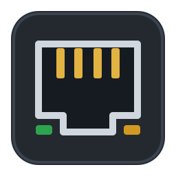
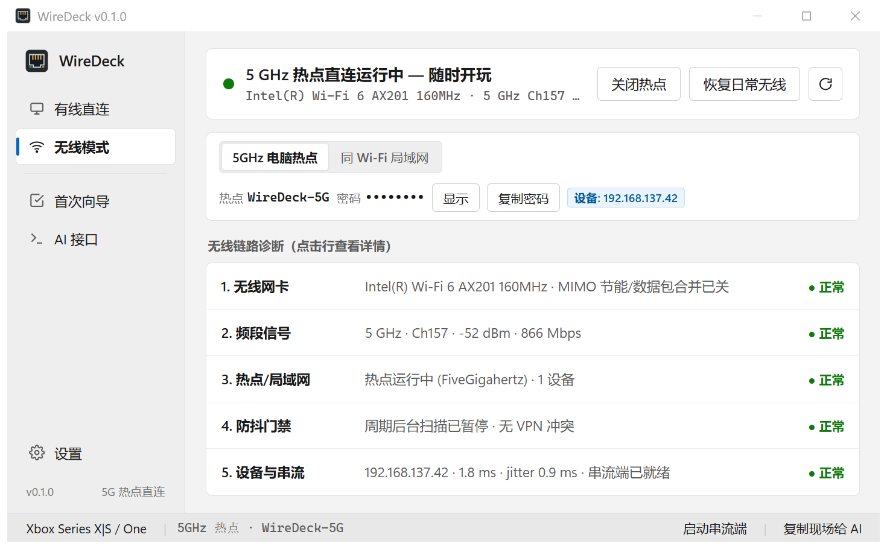
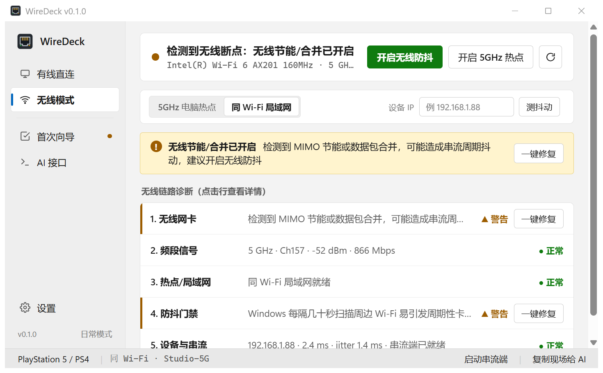
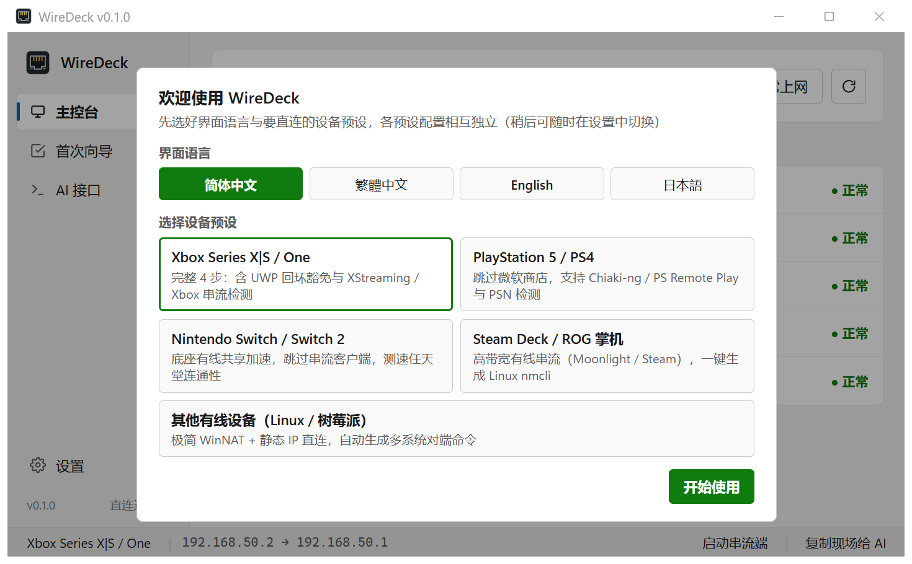
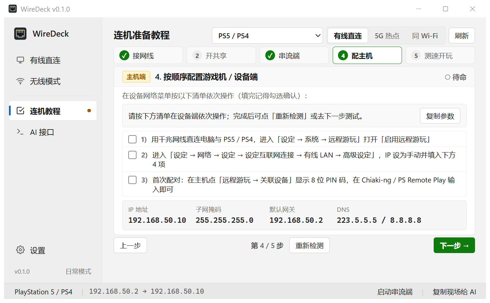

<div align="center">
  
  <h1>WireDeck</h1>
  <p><strong>笔记本与游戏机双模直连助手（千兆有线 + 5G 无线） · 4 语言 · 5 设备预设 · 6 层断点定位 · 原生 AI / DSH 扩展</strong></p>
  <p>
    
    
    
    
    
  </p>
</div>

---

**有线千兆直连 + 无线 5GHz 热点 / 防抖优化** 双板块并行，免采集卡、免额外路由器，避开 Windows ICS 冲突、VPN TUN 断流、校园网 AP 隔离、后台周期 Wi-Fi 扫描顿挫与微软商店回环隔离，看着状态灯点两下即可稳定串流开玩。

- **两大并列主板块**：
  - **有线直连**：纯净 `WinNAT` 零重启切换 + 6 层硬件/链路/冲突门禁定位（`0.41 ms` 直连 RTT，0 卡顿）。
  - **无线模式**：
    - **5GHz 电脑热点直连**：一键锁定 5 GHz Windows 移动热点、展示/复制 SSID 密码、自动发现接入设备 IP，直接绕开校园网/酒店 AP 隔离。
    - **同 Wi-Fi 局域网防抖**：安全可回滚（`wifi_backup.json`）一键关闭 `MIMOPowerSaveMode` / 数据包合并 / 激进漫游并暂停系统周期后台扫描，识别 2.4GHz 降频与 AP 隔离。
- **4 种界面语言 & 5 套独立设备预设**：简体中文 / 繁體中文 / English / 日本語；Xbox、PlayStation 5/4、Nintendo Switch/Switch 2、Steam Deck/ROG 掌机、其他设备各自独立保存参数并自动裁剪向导步骤。

## 实机界面一览

| 有线直连（千兆 WinNAT 运行中） | 无线模式（5 GHz 电脑热点 + 自动发现设备 IP） |
| :---: | :---: |
|  |  |

| 无线模式（同 Wi-Fi 局域网防抖提示） | 开局语言 / 连接方式 / 设备预设选择 |
| :---: | :---: |
|  |  |

<details>
<summary>展开查看交互式连机教程（Xbox / PS5）、断点拦截、AI / DSH 协作接口与深灰主题截图</summary>
<p align="center">
  
  
</p>
<p align="center">
  
  
</p>
<p align="center">
  
</p>
</details>

---

## 3 步极简上手

1. **选好模式与设备预设**：首次启动在弹窗中选择语言（简/繁/英/日）、连接方式（有线直连 / 无线模式）与目标设备，点击 **开始连机教程（首次推荐）** 即可进入引导。
2. **顺着「连机教程」一步步点过去**：界面按当前模式（有线直连 / 5G 热点 / 同 Wi-Fi）与设备预设自动编排 **电脑端一键操作 + 游戏机端编号勾选清单 + 实参复制/测速验收**（例如 PS5 含「启用远程游玩」及 8 位 PIN 配对引导；Xbox 含「启用远程功能」与借屏提示；热点模式附带 SSID/密码查看与设备自动发现），配置完成即可在末尾直接点击 **进入 XStreaming / Chiaki-ng / Moonlight** 或生成 **桌面一键开玩快捷方式**。
3. **日常一键切换**：
   - **有线直连**：断开 VPN → 点 **开启游戏直连** → 启动串流端；玩完点 **恢复日常上网**（1 秒无痕恢复，零重启）。
   - **无线模式**：点 **开启 5GHz 热点** 让游戏机直接连笔记本，或点 **开启无线防抖** 消除同路由 Wi-Fi 的周期性卡顿尖刺；玩完点 **恢复日常无线** 原样还原。

---

## 原生 AI / DSH 协作接口与内置 20 项工具库

在 **AI 接口** 页一键 **「复制现场发给 AI」** 即可导出脱敏诊断包（自动隐藏用户名与热点/代理密钥），内置 **20 个只读工具脚本**（含 10 个通用有线/无线探针 + 10 个按预设定制工具），支持界面直跑、`wiredeck-cli.exe` 调用或 DSH 热写入扩展：

```powershell
# 1. 有线 / 无线无头诊断与 20 项内置工具库
wiredeck-cli.exe diagnose --transport wired --json
wiredeck-cli.exe diagnose --transport wireless --json
wiredeck-cli.exe toolkit list --all --json
wiredeck-cli.exe toolkit run common/probe-wifi-rf-scan --json

# 2. 导出脱敏现场包 & 热加载扩展
wiredeck-cli.exe export-bundle --json
wiredeck-cli.exe ext validate <ext_dir> --json
```

完整 CLI 契约、内置 20 项工具库清单、`wiredeck-ext/v1` 热加载协议与可选本地 HTTP Bridge 说明见 [**docs/AI_EXTENSION_SPEC.md**](docs/AI_EXTENSION_SPEC.md)。

---

## 安装与校验

提供两种交付形态（均默认**无需管理员权限安装**，仅在修改网络/热点参数时按需触发标准 Windows UAC；卸载严格保留用户数据与扩展）：

- **一键安装器**：`WireDeck-v0.1.0-win64-setup.exe`（自带 `unins000.exe` 干净卸载与活跃 WinNAT 清理提醒）
- **免安装便携版**：`WireDeck-v0.1.0-win64-portable.zip`（内置 `portable.mode`，数据保存在目录内 `data\`）

```powershell
Get-FileHash .\WireDeck-v0.1.0-win64-setup.exe -Algorithm SHA256
```

## 开源协议

基于 [MIT License](LICENSE) 开源。
